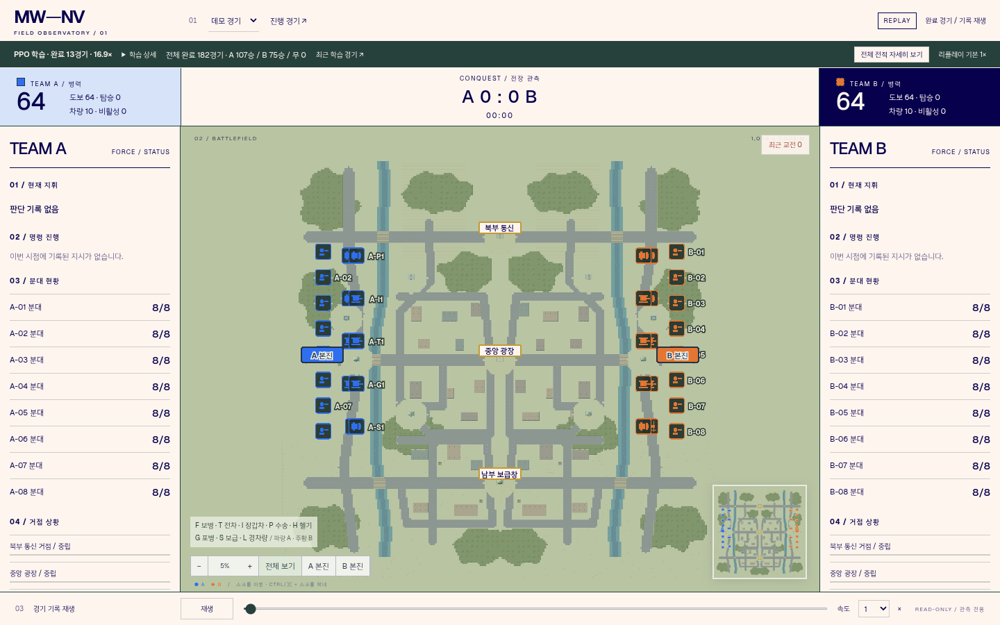
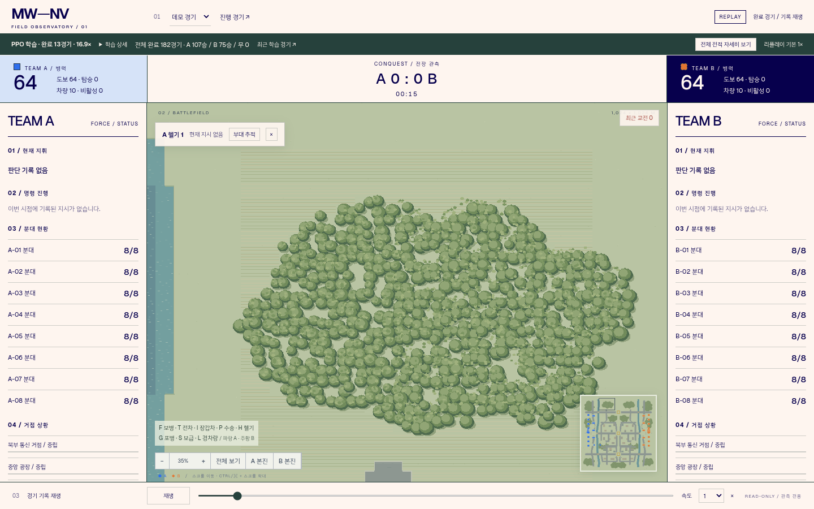
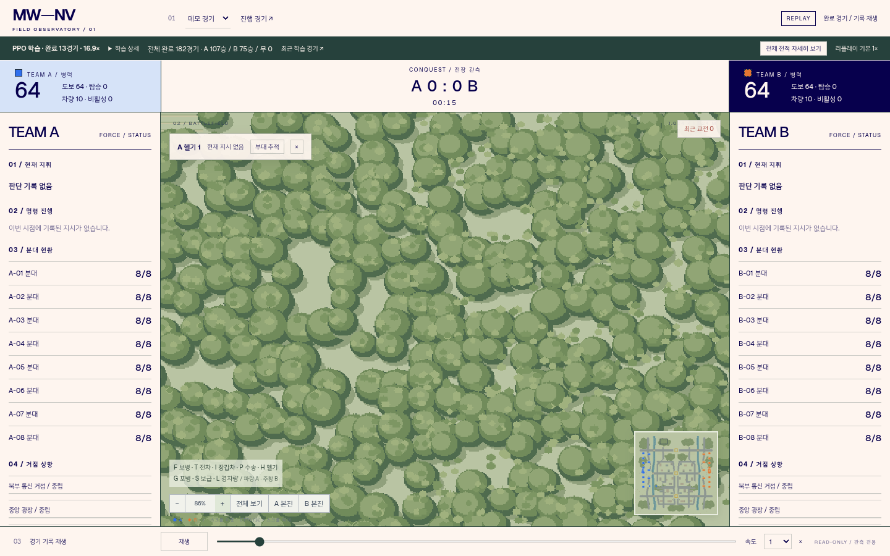
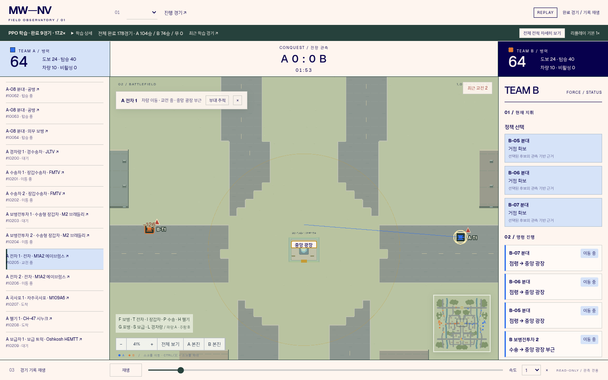
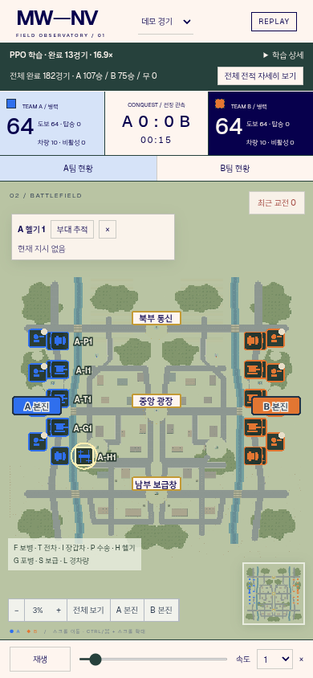

# T05 전장·관전 UI 개선 검증

사이트: https://mw-nv.pages.dev

## 변경과 근거

10개 진단과 공개 원문 참고는 [AUDIT.md](AUDIT.md)에 기록했다. Mapbox의 우선순위/충돌 억제, Godot 연결 타일과 프레임 애니메이션, OpenRA 팔레트/시트 안내를 원리로 적용했다. 외부 게임 자산이나 GPL 코드를 복사하지 않았다. 일반 웹 요청은 CONNECT403이어서 실제 읽은 GitHub 공개 원문만 근거로 사용했다.

- 전체 지도에서92×36 두 줄 태그를 제거했다.22px 병종 표식과 짧은 ID는 실제 좌표에 고정하고, 같은 팀/병종의 근접 군집을 합친다. 겹치는 ID는 숨긴다. 기물 위치를 밀어내지 않는다.
- 선택 부대만 명령/목표/상태/경로를 강조하고 패널과 연결한다. 차량 이동과 실제 탑승 수송의 문구를 구분했다. 드래그와 클릭을 구분하며, 수동 조작은 추적을 해제한다. 미니맵에서 전체보기 상태로 위치를 누르면 해당 영역으로 확대한다.
- 최근 실제 사격/탄착은 지역 단위로 묶고 작은 붉은 표식과 이동 목록을 제공한다. 표식은 기물 실루엣을 가리지 않게 옆으로 배치했다. 학습 현황은 요약과 접이식 상세로 분리했다.
- 강변1024m 지도는 숲/농지·주거 광장·산업 창고 구역으로 교체했다. 굽은 수로, 넓은 교량/주축/우회로, 연결된 지형 경계와 지붕, 군락형 나무를 제작했다. 물리 지형은 좌우 대칭이며 외형 해시와 애니메이션은 게임 RNG를 사용하지 않는다. 전차 주요 접근 경로는 양쪽에서584.8/384.8/672.8m로 일치했다(seed20000, 세 거점).
-24px native tile/48px world 배율, 자연스러운 저채도 재질, 일관된 명암과 제한된 디더링을 사용한다. 가까이서는 원형 보병과 실제 차량 모티브를 유지하며 축소 시 병종 아이콘으로 전환한다. 지형은 정적 합성 청크로 캐시한다.
- 직사 무기 종류(ap/cannon/rifle 및 발사자 병종)를 올바르게 구분하는 공유 VFX 시트를 추가했다. 발사/비행/탄착/먼지와 피해 숫자는 리플레이 시간과 기록 좌표를 사용한다. 장갑 무효와 빗나감도 구분한다. 소멸·정지·역방향 탐색에 wall clock이나 난수를 쓰지 않는다.

## 규칙·학습

rules combined-arms-3, catalog combined-arms-2, map river-districts v2. 명중 전차포는 직접 표적 중복 없이4m/최대40의 고폭 범위 피해를 적용한다. 공중/탑승 병사를 제외하고 살아 있는 대상을 먼저 고정해 비상 하차 중복 피해를 막는다. 아군 피해는 유지하며 AI 후보/자동 표적은 현재 아군 근접 위험을 피한다.

기존 리플레이는 자체 지형·catalog·이벤트로 화면 재생한다. 구형 규칙의 엔진 재실행/학습 복구는 거부하고 맵 식별자를 전적/리플레이/학습 보고에 기록한다. 자료가 없는 구형 기록에는 맵 —를 표시한다.

기존 worker는 백그라운드 SIGINT 상속 무시를 확인한 후 TERM으로 종료했다. 마지막 소비된 PPO checkpoint(gen256,93경기,23040스텝)를 data/self-play-v2에 보존했다. 새 worker에는 명시적 SIGINT/TERM 안전 업데이트 경계 처리를 추가했다. rules2 actor만 이전하고 critic/optimizer/teacher buffer/학습 카운터는 새로 시작했다.64→128스텝 복구 재개와 NumPy 일치를 확인한 후 data/self-play-v3에서 실제 paired NIM teacher 학습을 재개했다. 모델·키·대형 로그는 Git에 넣지 않았다. 이전 원격 Release 업로드 차단은 아직 해결되지 않았다.

## 검증

- 전체 Python150개 통과 + 후속 관측 격리/아군 위험 후보1개 통과. upstream anyio deprecation warning1개. 규칙 버전 고정 테스트2개의 초기 실패는 실제 버전별 분리 계약에 맞게 수정 후 통과했다.
- JavaScript22개 통과; production build와 Pages Functions 컴파일 통과.
- Chromium1440×900/1024×768/390×844: 전체보기, 부대 선택·추적, 드래그 시 추적 해제, 접이식 학습 정보, 모바일 패널, 스크롤 폭 검사 통과.500유닛 스트레스와 실제 rules3 리플레이 VFX/정지/역탐색/hover 해제를 검사했다.
- 렌더링 성능은 browser.json에 기록한 클라우드 Chromium SwiftShader 결과다. 실제 Intel Mac 성능은 미검증이며 이 수치를 Mac 성능으로 환산하지 않는다.
- 수정 후10개 완료 경기와 동일 seed/actions 상태 해시 재실행 통과. 결과·해석은 [GAMES.md](GAMES.md), 기계 수치는 games.json. A5/B5이나 서쪽8/동쪽2; 경로·교통 명령 실패가 남아 있다.10경기에서 전략 향상/밸런스 확보를 주장하지 않는다.

## 배포와 한계

Pages preview 배포의 success는 Cloudflare API에서 확인했다. preview 서브도메인 HTTP 요청은 환경 네트워크 CONNECT403으로 막혀 실제 원격 화면 검사는 못 했다(preview.json). 같은 빌드의 로컬 Chromium 검사 후 정식 배포의 HTML/정적 자산/전적/새 규칙 리플레이를 따로 확인한다. Production Secret을 복사하거나 공개하지 않는다. 이전 production 배포는 rollback용으로 보존한다.

PPO는 현재 Codex CPU 환경에서 동작한다. Pages에는 학습 프로세스를 올리지 않았으며 환경 종료 후 상시 실행을 보장하지 않는다. 새 유료 서비스나 외부 CPU 서버를 만들지 않았다. 사용량 UNKNOWN.

## 화면

## 사용자 요청으로 중간 저장

2026-10-25 개발 중단. 핵심 배포6af5b1f9는 성공했지만 공개 주소 API 검증과 최종 UI polish 재배포는 아직 하지 않았다. 최종 로컬 build/JS22/이동 부대 추적 포함 Chromium 검사는 통과했다. 최종500유닛 결과20FPS는 클라우드 SwiftShader이며 Intel Mac 결과가 아니다. 개발 중단 시 학습 worker는 계속 실행 중이었다(gen36, 새13경기,2304스텝, paired teacher34). 새 학습 모델은 ignored data/self-play-v3에 보존하며 원격 Release 백업은 여전히 차단돼 있다. 모델이 Git에 올라갔다고 간주하지 않는다.
